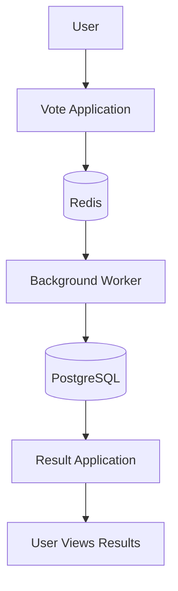

# 🗳️ Cloud-Native Voting Application

A containerized, microservices-based voting application designed to demonstrate modern DevOps practices, including Docker, Kubernetes, CI/CD automation, infrastructure as code, security scanning, and monitoring.

## 📌 Project Overview

This project demonstrates how to build, containerize, deploy, and manage a voting application using cloud-native technologies.

The application allows users to cast votes, processes votes through a background worker, and displays the results through a separate web application.

## 🏗️ Application Architecture



### Application Components

| Component | Responsibility |
|---|---|
| Vote | Accepts votes from users |
| Worker | Processes votes in the background |
| Redis | Stores votes temporarily for processing |
| PostgreSQL | Stores processed voting data |
| Result | Displays voting results |
| Kubernetes | Orchestrates application containers |

## 🛠️ Technology Stack

- **Version Control:** Git, GitHub
- **CI/CD:** Jenkins
- **Containerization:** Docker
- **Container Orchestration:** Kubernetes
- **Package Management:** Helm
- **Infrastructure as Code:** Terraform
- **Cloud Platform:** AWS
- **Container Registry:** Amazon ECR
- **Code Quality:** SonarQube
- **Security Scanning:** Trivy
- **Monitoring and Visualization:** Prometheus, Grafana

*Note: The tools listed above describe the intended DevOps toolchain. Update this list as you implement and verify each integration.*

## 🔄 CI/CD Pipeline

The intended CI/CD workflow is:

1. **Code Commit:** Developers push changes to GitHub.
2. **Continuous Integration:** Jenkins detects changes and starts the pipeline.
3. **Automated Testing:** Run available unit tests and application checks.
4. **Code Quality:** Analyze code using SonarQube and enforce the configured quality gate.
5. **Security Scanning:** Scan source code, dependencies, and container images using appropriate security tools.
6. **Docker Build:** Build container images for the application components.
7. **Image Publishing:** Push validated images to Amazon ECR.
8. **Infrastructure Provisioning:** Use Terraform to provision the required AWS infrastructure.
9. **Application Deployment:** Deploy application components to Kubernetes using Helm.
10. **Verification:** Validate pod health, service connectivity, and application availability.
11. **Monitoring:** Use Prometheus and Grafana to monitor application and cluster health.

## ☁️ AWS Infrastructure

The planned AWS deployment can include:

- Amazon VPC
- Public and private subnets across multiple Availability Zones
- Internet Gateway and NAT Gateway, as required
- Amazon EKS
- Application Load Balancer
- Amazon ECR
- IAM roles and policies
- Route 53 for DNS
- CloudFront for content delivery, if required by the deployment architecture
- CloudWatch for AWS infrastructure logs and metrics

Terraform can be used to provision and manage the infrastructure through reusable modules and remote state.

## ☸️ Kubernetes Deployment

The application can be deployed to Kubernetes using the manifests available in the `k8s-specifications` directory.

Deployment considerations include:

- Deployments for application components
- Services for internal communication
- ConfigMaps for non-sensitive configuration
- Secrets for sensitive values
- Readiness and liveness probes
- CPU and memory requests and limits
- Rolling updates and rollback
- Ingress or LoadBalancer services for external access

## 📊 Monitoring and Observability

Prometheus and Grafana can be used to monitor:

- Kubernetes node and pod health
- CPU and memory utilization
- Pod restarts and deployment availability
- Application performance
- Request errors and latency, where instrumentation is configured
- Alert conditions for critical resource thresholds

CloudWatch can provide additional AWS infrastructure and application logging.

## 🔐 Security Best Practices

- Store credentials in a secrets manager or an appropriate Kubernetes secrets solution.
- Use IAM roles and least-privilege access.
- Scan container images for known vulnerabilities.
- Enforce code-quality and security gates in CI/CD.
- Avoid committing credentials, tokens, or private keys.
- Use private subnets for workloads where appropriate.
- Pin container image versions and use controlled deployment processes.

## 📁 Repository Structure

```text
voting-app/
├── k8s-specifications/
├── result/
├── seed-data/
├── vote/
├── worker/
└── README.md
```

## 🚀 Getting Started

### 1. Clone the repository

```bash
git clone https://github.com/Gopidesi19/voting-app.git
cd voting-app
```

### 2. Review the application files

```bash
ls -la
ls -la k8s-specifications
```

Review the Kubernetes manifests and application-specific instructions before deploying.

### 3. Build container images

Build each component using its corresponding Dockerfile and build context.

```bash
docker build -t vote-app:latest ./vote
docker build -t result-app:latest ./result
docker build -t worker-app:latest ./worker
```

These commands assume Dockerfiles exist at the specified paths. Adjust the commands to match the repository.

### 4. Deploy to Kubernetes

Ensure that a Kubernetes cluster is configured and that `kubectl` points to the intended cluster.

```bash
kubectl config current-context
kubectl get nodes
```

Review the available manifests, configure the required images and dependencies, and apply the appropriate resources:

```bash
kubectl apply -f k8s-specifications/
```

Verify the deployment:

```bash
kubectl get deployments
kubectl get pods
kubectl get services
```

The deployment commands assume the manifests are complete and configured for the target cluster.

## 🧪 Validation and Troubleshooting

Useful Kubernetes commands:

```bash
kubectl get pods -A
kubectl describe pod <pod-name>
kubectl logs <pod-name>
kubectl get events --sort-by=.metadata.creationTimestamp
kubectl rollout status deployment/<deployment-name>
kubectl rollout history deployment/<deployment-name>
```

For a failed rollout, inspect pod events, container logs, image availability, resource limits, configuration, and service connectivity before attempting a rollback.

## 🎯 Project Objectives

- Implement a repeatable CI/CD pipeline.
- Build and publish container images.
- Automate cloud infrastructure provisioning.
- Deploy microservices to Kubernetes.
- Apply DevSecOps practices.
- Implement monitoring and alerting.
- Improve deployment consistency and operational visibility.
---

This project is intended for hands-on learning and demonstration of cloud-native application delivery and DevOps automation.
